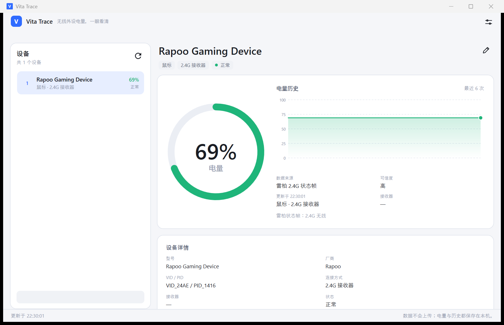

# Vita Trace

> 一眼看清无线键盘、鼠标还剩多少电。

Vita Trace 是一个 Windows 桌面小工具，把无线外设的电量、连接状态和历史变化放在一个窗口里。它不会安装驱动，不需要管理员权限，也不会把设备信息上传到网络。



当前版本：**0.7.0**（早期版本）

---

## 下载与运行

在 GitHub 仓库的 **Releases** 页面下载：

```text
VitaTrace-0.7.0-win-x64.zip
```

解压后双击 `VitaTrace.exe` 即可，不需要安装 .NET，也不需要管理员权限。

如果 Windows 提示“未知发布者”，这是免费工具的常见提示：点“更多信息 → 仍要运行”即可。

### 安装到开始菜单（可选）

解压后右键 `install.ps1` → **使用 PowerShell 运行**，程序会安装到当前用户目录，并在开始菜单创建快捷方式，不需要管理员权限。

如果系统禁止运行 PowerShell 脚本，直接用绿色版即可。

### 卸载

- 绿色版：删除解压出来的文件夹。
- 安装版：运行安装目录里的 `uninstall.ps1`；加 `-RemoveData` 会同时删除设置、日志和历史记录。

---

## 它能做什么

- **自动发现设备**：插入 USB 接收器、蓝牙设备或有线外设后，列表会自动更新。
- **电量圆环**：外圈弧度就是电量，圈内显示百分比；电量低于 20% 显示红色。
- **历史曲线**：每次成功读取会留下采样点，鼠标悬停可以看时间和电量；重启后历史仍然保留。
- **低电量提醒**：电量低于设定阈值时，托盘圆圈变红并弹出气泡；窗口打开时还会闪任务栏。
- **托盘显示**：每台能读到电量的设备有一个带序号的圆环图标，数字与左侧列表一致。
- **自定义名称**：点标题右侧的铅笔，给设备起一个自己看得懂的名字，重启后保留。
- **明暗主题和中英文切换**：设置里可以跟随系统，也可以手动选择。
- **关闭到托盘**：点关闭按钮不会退出，而是收进托盘继续刷新。

---

## 支持情况

电量能不能读到，取决于设备厂商有没有开放电量读取方式。Vita Trace 只显示有依据的读数，读不到会明确写“不支持读取”或“读取失败”，不会用 0% 或 100% 冒充。

| 设备 | 连接方式 | 当前情况 |
| --- | --- | --- |
| 雷柏 VT7 Max | 2.4G 接收器 | **已实测**，能读到真实百分比 |
| 迈从 G98 Pro 键盘 | 2.4G 接收器 | **已实测**，能读到真实百分比 |
| ERAZER 办公鼠标（YICHIP 接收器） | 2.4G 接收器 | 没有可用的电量通道，显示“不支持读取” |
| 部分蓝牙设备 | 蓝牙 | 取决于 Windows 是否提供电量；未广泛实测 |
| 有线键盘、鼠标 | USB | 显示“有线供电”，不显示虚假电量 |

其他品牌和型号没有逐一适配。遇到读不到的设备，程序会如实标记，不会编造一个数字。

---

## 使用说明

1. 打开 Vita Trace，左侧是设备列表，右侧是选中设备的详情。
2. 电量圆环里的百分比是当前读数；下方会写数据来源、可信度和更新时间。
3. 圆环右边的曲线是历史记录，鼠标移上去可以看到具体时间和电量。
4. 点标题右侧的铅笔可以重命名；按 Enter 保存，Esc 取消，留空恢复系统名称。
5. 关闭窗口后程序仍在托盘运行；单击托盘图标可以重新打开。

### 托盘图标

- 任务栏和 `^` 里的 **V** 图标是 Vita Trace 程序图标。
- `^` 旁边的圆形图标才是设备电量：圈内数字对应左侧列表序号，绿色表示 20% 及以上，红色表示低于 20%。
- 读不到电量的设备不会生成托盘图标，所以托盘数字可能不连续。
- Windows 11 默认把新图标收进 `^`。如果看不到，点一下 `^`；仍看不到时，到“设置 → 个性化 → 任务栏 → 其他系统托盘图标”里打开 Vita Trace。
- 如果关闭窗口后找不到程序，再次双击 Vita Trace 会把隐藏的窗口唤回来。

---

## 数据与隐私

所有数据都保存在本机：

```text
%LOCALAPPDATA%\VitaTrace\settings.json   设置
%LOCALAPPDATA%\VitaTrace\history.json    电量历史
%LOCALAPPDATA%\VitaTrace\logs\app.log    运行日志
```

- 不联网，不上传设备信息。
- 不需要管理员权限；开机启动只写当前用户的启动项。
- 删除 `%LOCALAPPDATA%\VitaTrace` 即可清空所有本地数据。

---

## 常见问题

**为什么某台设备没有百分比？**

可能是设备没有公开电量读取方式，或者接收器只负责转发数据、系统拿不到。程序会显示“不支持读取”或“暂时无法获取”，不会生成假数据。

**鼠标放一会儿就显示“读取失败”？**

部分无线鼠标休眠后会停止上报状态。移动一下鼠标，再点刷新即可恢复。

**关闭后程序去哪了？**

默认收进系统托盘，继续在后台刷新。单击托盘里的 V 图标，或再次双击 Vita Trace，都能重新打开。

**为什么任务栏和 `^` 里各有一个 V？**

任务栏上是窗口按钮，`^` 里是托盘图标；两者都是程序图标，不是两台设备。

**Windows 提示“未知发布者”怎么办？**

Windows 可能会提示“未知发布者”，这是免费工具的常见提示。点“更多信息 → 仍要运行”即可。请只从本仓库的 Releases 页面下载。

**支持蓝牙耳机吗？**

如果 Windows 向应用提供了电量属性，就会显示；没有提供时会标“不支持”。目前只对部分蓝牙设备做过验证。

**支持有线外设吗？**

支持识别和显示连接状态，但有线设备由 USB 供电，没有“电池百分比”这个概念，因此显示“有线供电”。

---

## 系统要求

- Windows 10 1809 或更高版本，Windows 11
- 64 位系统
- 约 100 MB 磁盘空间（含运行文件和本地历史）
- 不需要管理员权限

---

## 反馈

遇到问题时，请在 GitHub Issues 里说明：

- 设备品牌和型号
- 连接方式（2.4G 接收器 / 蓝牙 / 有线）
- 程序里显示的状态
- 日志文件 `%LOCALAPPDATA%\VitaTrace\logs\app.log` 的最后一段

日志里可能包含设备名称和连接信息，提交前请确认没有不希望公开的内容。

---

## 版本

**0.7.0**：支持雷柏 2.4G 鼠标、迈从 G98 Pro 键盘的真实电量读取；支持历史曲线、低电量提醒、多设备托盘、重命名、明暗主题和中英文切换。

这是早期版本，设备兼容性仍在完善。读不到的设备会明确标记，不会伪造数据。
