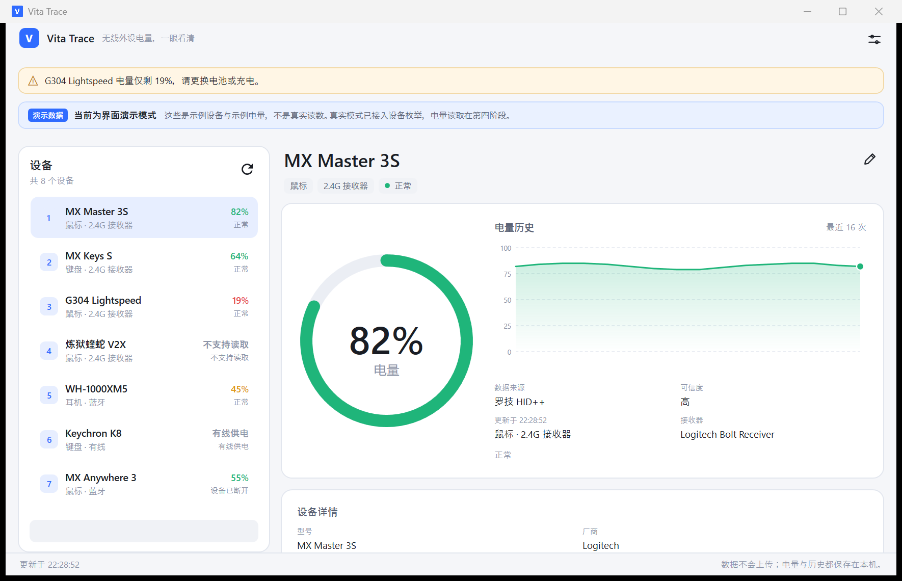
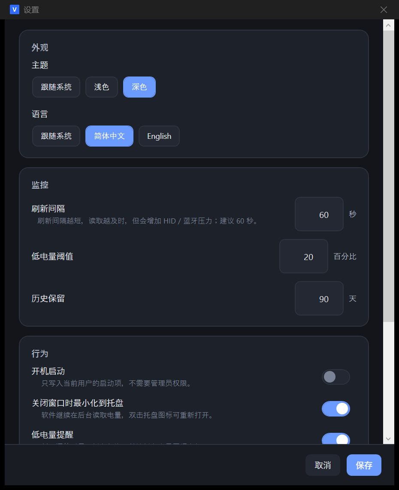

# Vita Trace — 第二阶段：技术架构与 UI 原型

> 状态：第二阶段可运行骨架已完成，等待验收。
> 本文记录技术选型、项目结构、界面原型、状态处理、构建方式和当前限制。
> 本阶段**只使用演示数据**，真实 USB / HID / BLE 枚举从第三阶段开始实现。
>
> 后续更新：第三阶段已接入真实 HID 枚举，真实模式不再显示空状态；本文中“真实模式空状态”的描述只代表第二阶段当时状态。当前实现见 [阶段3-设备枚举与HID识别.md](阶段3-设备枚举与HID识别.md)。

---

## 1. 本阶段目标

第二阶段要解决的是“骨架能不能跑起来”，而不是“电量读数准不准”：

1. 建立可长期维护的解决方案结构（App / Core / Infrastructure）。
2. 跑通一个接近最终形态的主窗口：左侧设备列表、右侧电量圆环 + 历史曲线。
3. 跑通设置窗口、主题切换、中英文切换、托盘、低电量提醒、关闭进托盘。
4. 用**明确标注的演示数据**验证界面与交互；真实模式不得显示任何假电量。

验收标准：

- `dotnet build` 成功，0 error。
- `--demo` 启动后能看到完整主界面、设置窗口、明暗主题、中英文切换。
- 真实模式（不带 `--demo`）显示空状态，不显示演示设备，不显示假百分比。
- 关闭窗口进入托盘，托盘菜单可以重新打开、刷新、退出。

---

## 2. 技术栈与取舍

| 项目 | 选择 | 原因 |
| --- | --- | --- |
| UI 框架 | WPF | Win32 / HID / PnP 互操作成熟，托盘、图表、单文件发布都有成熟做法；Win10/11 覆盖好 |
| 运行时 | .NET 10 LTS | 长期支持；WPF 在新版本上仍是一等公民 |
| 架构 | MVVM + 分层 | 设备枚举、电量读取、界面展示分离，后续换真实实现不改 UI |
| 托盘 | WinForms `NotifyIcon` | 不引入第三方托盘库，WinForms 只用于托盘，不用于界面 |
| 设置存储 | `System.Text.Json` + 本地文件 | 无外部依赖；设置量小，不需要数据库 |
| 历史记录 | 现阶段内存集合，第四阶段接 SQLite | 第二阶段还没有真实采样，先验证曲线控件 |
| 图表 | 自绘 `Sparkline` | 避免引入图表库；曲线逻辑简单、可控 |
| 图标 | 矢量 `Path` + 本地 `.ico` | 不依赖图标字体，避免不同系统字体缺失出现方框 |

**没有引入任何第三方 NuGet 包。** 原因是当前开发机网络受限（TLS 握手失败，只有 Node 能联网），同时本阶段所需能力用 BCL + Win32 已经足够。后续如果引入 SQLite / 日志库，会在对应阶段单独评估许可证与维护成本。

---

## 3. 解决方案结构

```text
E:\Vita Trace\
├─ VitaTrace.slnx
├─ Directory.Build.props
├─ build.ps1
├─ README.md
├─ docs\
│  └─ 阶段2-技术架构与UI原型.md
├─ src\
│  ├─ VitaTrace.Core\                 # 纯业务模型与接口，不依赖 WPF
│  │  ├─ Models\
│  │  │  ├─ DeviceEnums.cs            # 设备类型、连接方式、电量状态、来源、可信度
│  │  │  ├─ BatteryReading.cs         # 一次电量读数（含来源/时间/可信度/原始说明）
│  │  │  ├─ BatterySample.cs          # 历史采样点
│  │  │  ├─ PeripheralDevice.cs       # 接收器或外设的统一实体
│  │  │  └─ AppSettings.cs            # 用户设置 + Normalize 校验
│  │  └─ Abstractions\
│  │     ├─ IAppLogger.cs
│  │     ├─ ISettingsStore.cs
│  │     ├─ IDeviceEnumerator.cs
│  │     └─ IBatteryReader.cs
│  ├─ VitaTrace.Infrastructure\       # 平台/存储/日志实现
│  │  ├─ Storage\AppPaths.cs
│  │  ├─ Storage\JsonSettingsStore.cs
│  │  └─ Logging\FileLogger.cs
│  └─ VitaTrace.App\                  # WPF 界面与组合根
│     ├─ App.xaml / App.xaml.cs
│     ├─ MainWindow.xaml / .xaml.cs
│     ├─ Themes\                      # Shared / Light / Dark
│     ├─ Resources\                   # Strings.zh-CN / en-US
│     ├─ Controls\BatteryRing.cs      # 电量圆环，带悬停动画
│     ├─ Controls\Sparkline.cs        # 历史曲线，带悬停十字线
│     ├─ ViewModels\
│     ├─ Views\SettingsWindow.xaml
│     └─ Services\                    # 托盘、主题、语言、启动项、窗口效果
└─ tests\                             # 预留；当前无离线测试包
```

依赖方向：

```text
App  ──►  Core
 │
 └────►  Infrastructure  ──►  Core
```

`Core` 不引用 WPF、不引用 WinForms、不引用注册表；这样第三阶段可以把真实枚举器放进 Infrastructure 或新的 Platform 项目，UI 不需要改。

---

## 4. 核心模型与状态机

### 4.1 设备实体

`PeripheralDevice` 同时表示接收器和外设，通过 `Kind` / `Connection` 区分：

- `Kind`：Unknown / Keyboard / Mouse / Headset / Gamepad / Receiver / Other
- `Connection`：Unknown / UsbReceiver / Bluetooth / Wired
- `ReceiverId` / `ReceiverName`：外设属于哪个接收器；无法确定时为空，**不编造对应关系**
- `BatteryStatus` / `Battery`：当前状态与最近一次读数
- `IsDemo`：是否是演示数据

显示名称优先级：用户别名 → 系统名称 → “未知设备”。

### 4.2 电量状态

`BatteryStatus` 明确区分：

| 状态 | 含义 | UI 表现 |
| --- | --- | --- |
| `Ok` | 读取成功 | 显示百分比 + 绿色/黄色/红色 |
| `Stale` | 上次成功，但本次没刷新到 | 显示上次值，标注“可能已过期” |
| `ReadFailed` | 有通路但读取失败 | 显示“读取失败”，不显示百分比 |
| `Unsupported` | 硬件没有电量通道 | 显示“不支持读取” |
| `Disconnected` | 外设断开 | 显示“设备已断开” |
| `ReceiverOffline` | 接收器断开 | 显示“接收器断开” |
| `Wired` | 有线设备 | 显示“有线供电”，不显示百分比 |
| `Unknown` | 尚未读取 | 显示“—”，不猜 |

**任何状态下都不会生成随机值或固定值。** `BatteryReading.FromPercent` 会检查 0–100 越界并抛异常，避免错误数据静默进入界面。

### 4.3 刷新

- 默认 60 秒，设置范围 15–3600 秒。
- `MainViewModel` 用 `DispatcherTimer` 每秒检查是否到达下一次刷新时间，避免高频 UI 刷新。
- 刷新串行执行，`IsRefreshing` 防止重入。
- 失败不会把旧值改成 0；保留旧值并标记 `ReadFailed` / `Stale`。

---

## 5. 界面原型

### 5.0 实际截图

浅色主题主界面（演示数据）：



深色主题设置窗口：



### 5.1 主窗口

```text
┌──────────────────────────────────────────────────────────────┐
│ [V] Vita Trace  无线外设电量，一眼看清            [设置]     │  ← 品牌区
├──────────────────────────────────────────────────────────────┤
│ ⚠ G304 Lightspeed 电量仅剩 19%，请更换电池或充电。          │  ← 低电量横幅
│ [演示数据] 当前为界面演示模式 ...                            │  ← 演示横幅（仅 demo）
├───────────────────┬──────────────────────────────────────────┤
│ 设备              │  MX Master 3S                            │
│ 共 8 个设备       │  [鼠标] [2.4G 接收器] [正常]             │
│ ┌───────────────┐ │  ┌──────────────┐  ┌──────────────────┐  │
│ │ MX Master 3S  │ │  │              │  │ 电量历史          │  │
│ │ 82%    正常   │ │  │    82%       │  │  ╱╲╱╲╱╲          │  │
│ └───────────────┘ │  │   电量       │  │  最近 16 次       │  │
│ ┌───────────────┐ │  └──────────────┘  └──────────────────┘  │
│ │ MX Keys S    │ │  数据来源：罗技 HID++   可信度：高        │
│ │ 64%    正常  │ │  更新时间：00:15:41     接收器：Bolt       │
│ └───────────────┘ │  设备详情：型号 / 厂商 / VID:PID / 路径   │
│ ...               │                                          │
├───────────────────┴──────────────────────────────────────────┤
│ 更新于 00:15:41                  数据不会上传；真实设备支持… │
└──────────────────────────────────────────────────────────────┘
```

要点：

- 使用 Windows 原生标题栏，保留系统的最小化/最大化/关闭、贴靠布局和窗口阴影。
- 品牌区只保留应用名、副标题和设置入口，避免和系统标题栏重复。
- 左侧固定 330 DIP，设备多时列表滚动；右侧详情滚动，避免小屏幕裁切。
- 圆环支持 0–100%，`null` 时显示“—”；悬停轻微放大。
- 曲线纵轴固定 0–100，缺失值断线，不插值；悬停显示时间/电量气泡。
- 接收器没有电池，显示“有线供电”，不画 0% 圆环。

### 5.2 设置窗口

四个分区：

1. **外观**：主题（跟随系统 / 浅色 / 深色）、语言（跟随系统 / 简体中文 / English）。
2. **监控**：刷新间隔、低电量阈值、历史保留天数。
3. **行为**：开机启动、关闭窗口时最小化到托盘、低电量提醒。
4. **关于**：版本、日志目录、数据目录、打开目录。

设置窗口单例：重复点击设置按钮只会激活已有窗口，不会叠出多个。保存成功后立即应用主题/语言；保存失败在窗口底部显示错误，不关闭窗口。

### 5.3 托盘与低电量

- 关闭窗口 → 隐藏到托盘（首次提示一次）。
- 托盘菜单：打开 / 刷新 / 退出；双击托盘图标打开主窗口。
- 低电量：托盘气泡 + 图标红色叠加；窗口可见时 `FlashWindowEx` 闪任务栏。
- 托盘模式下没有任务栏按钮，因此不能只依赖“任务栏图标闪动”，否则用户看不到提醒。

---

## 6. 演示模式与真实模式边界

演示模式：

- 启动参数：`--demo`。
- 使用 `DemoDeviceEnumerator` 的 8 个固定示例设备，全部 `IsDemo = true`。
- 界面顶部显示“演示数据 / 当前为界面演示模式”。
- 不访问真实设备，不写真实设置文件（使用 `settings.demo.json`）。

真实模式：

- 不带 `--demo`。
- 当前阶段使用 `EmptyDeviceEnumerator`，显示空状态：“还没有检测到设备”。
- **不会回退到演示数据**，不会显示任何假百分比。
- 第三阶段接入真实枚举后，空状态才会被真实设备替换。

这是刻意的边界：第二阶段验收 UI，但不伪装成已经能读真实电量。

---

## 7. 构建与运行

### 7.1 环境

- Windows 10 1809+ / Windows 11。
- .NET SDK 10.0.4xx。
- 本机 SDK 安装在项目内 `E:\Vita Trace\.dotnet`（不写系统目录、不改 PATH）；系统原有的 .NET 9 保持不变。

### 7.2 构建

```powershell
# 在 E:\Vita Trace 下
.\build.ps1
```

或手动：

```powershell
$env:DOTNET_CLI_HOME = "E:\Vita Trace\.dotnet-home"
$env:NUGET_PACKAGES   = "E:\Vita Trace\.nuget\packages"
& "E:\Vita Trace\.dotnet\dotnet.exe" build "E:\Vita Trace\VitaTrace.slnx" `
    -c Debug -m:1 -p:UseSharedCompilation=false
```

`-m:1 -p:UseSharedCompilation=false` 是当前沙箱环境的限制：命名管道被禁用，MSBuild 多节点和编译器服务器会失败。正常开发机可以去掉。

### 7.3 运行

```powershell
$env:DOTNET_ROOT      = "E:\Vita Trace\.dotnet"
$env:VITATRACE_DATA_DIR = "E:\Vita Trace\.tmp\appdata-demo"
& "E:\Vita Trace\.dotnet\dotnet.exe" `
    "E:\Vita Trace\src\VitaTrace.App\bin\Debug\net10.0-windows\VitaTrace.dll" --demo
```

`VITATRACE_DATA_DIR` 只用于开发/测试时把数据写到工作区；正常运行时省略，使用 `%LOCALAPPDATA%\VitaTrace`。

### 7.4 数据位置

| 内容 | 路径 |
| --- | --- |
| 设置 | `%LOCALAPPDATA%\VitaTrace\settings.json` |
| 演示设置 | `%LOCALAPPDATA%\VitaTrace\settings.demo.json` |
| 日志 | `%LOCALAPPDATA%\VitaTrace\logs\app.log` |
| 历史（第五阶段） | `%LOCALAPPDATA%\VitaTrace\history.json` |

---

## 8. 本阶段已验证 / 未验证

已验证：

- `dotnet build` 成功，0 warning / 0 error。
- `--demo` 主窗口可以启动，8 个演示设备、圆环、曲线、低电量横幅正常。
- 设置窗口可以打开；重复点击只保留一个窗口。
- 主题切换：浅色 / 深色资源字典切换正常。
- 语言切换：简体中文 / English 界面文案切换正常，设置写入 `settings.demo.json`。
- 应用图标：主窗口标题栏、任务栏、设置窗口使用本地 `.ico`。
- 关闭窗口进托盘、托盘菜单、低电量日志已跑通（托盘气泡未做逐帧截图验证）。

未验证 / 留到后续阶段：

- 真实 USB / HID / BLE 枚举与电量读取（第三、四阶段）。
- SQLite 历史持久化（第四阶段）。
- 真实设备上的低电量气泡与任务栏闪烁（需要真实外设与前台窗口）。
- 开机启动在真实重启后的行为（只验证了 HKCU 写入路径）。
- 安装包、代码签名、自动更新（第七阶段）。
- 多显示器 / 不同 DPI 下的全面回归（当前只验证 150% 单屏）。

---

## 9. 已知限制

1. 接收器没有电池，不能显示“接收器电量”；只能显示 USB 供电状态。
2. 非罗技 2.4G 接收器通常不暴露“接收器→外设”的映射，真实阶段只能显示“接收器已连接，外设未知”。
3. 蓝牙经典设备多数没有标准电量通道；BLE 的 PnP 缓存可能滞后或卡在 100%。
4. 罗技 HID++ 需要逐型号能力探测，不能假设所有罗技设备都支持同一 feature。
5. 演示数据只用于 UI 验收，不代表真实兼容性。

---

## 10. 下一阶段入口

第三阶段：实现真实设备枚举与 USB/HID 识别。

计划：

1. 用 SetupAPI / CfgMgr32 枚举 HID 设备接口与父设备。
2. 用 `HidD_GetAttributes` / `HidD_GetProductString` 获取 VID/PID、厂商、产品名。
3. 用 `HidP_GetCaps` 读取 Usage Page / Usage，识别键盘、鼠标、厂商自定义页。
4. 用 container ID / parent 关系建立“接收器—外设”候选关系，输出置信度。
5. 接收器识别只做启发式，结果标注置信度，不编造型号。
6. 把真实枚举结果接进 `MainViewModel`，替换 `EmptyDeviceEnumerator`。

验收：真实插拔一个 USB 接收器 / 蓝牙设备，界面能出现/移除对应条目，且不会出现演示数据。
