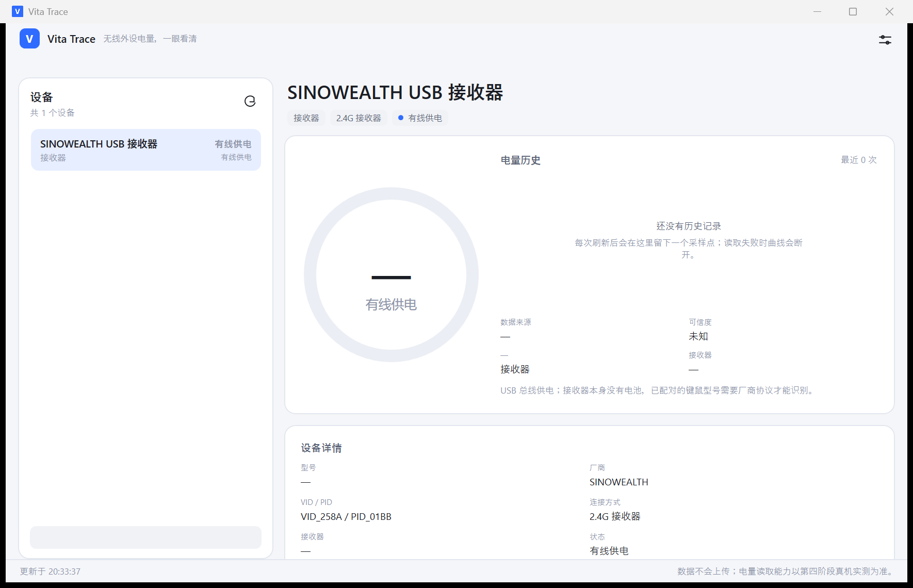
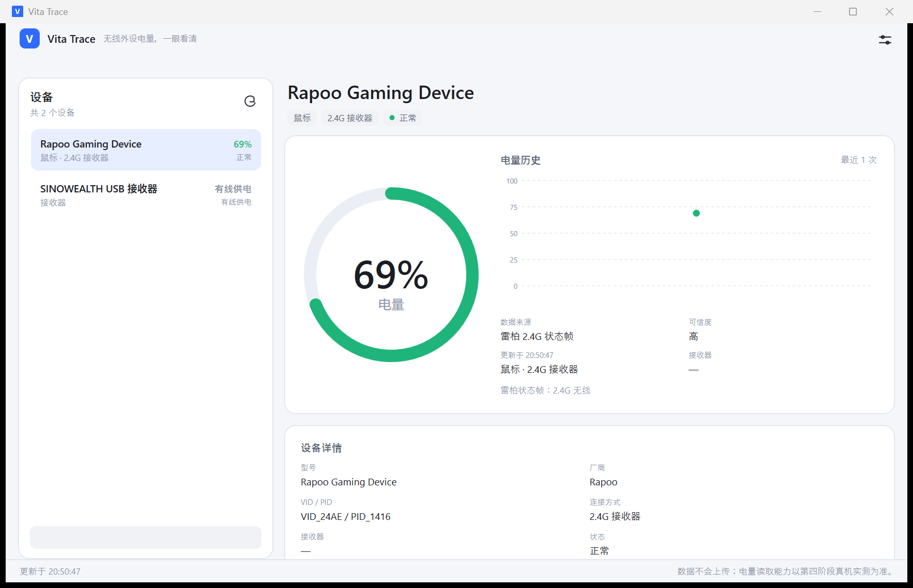
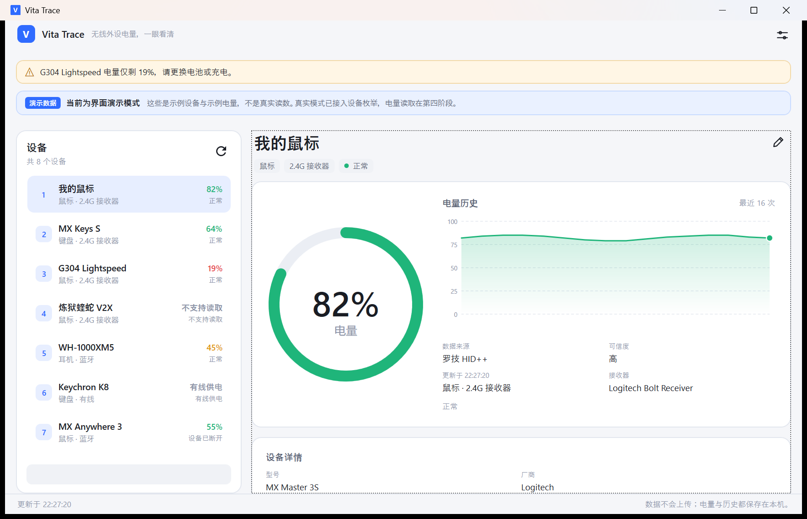

# Vita Trace — 第四阶段：真实电量读取与协议验证

> 状态：第四阶段进行中。
> 已完成只读探针、雷柏 2.4G 被动状态帧读取、迈从 G98 Pro 键盘 0x13/0x4A 读取、CompX / MCHOSE 两条候选协议实现，以及一个关键 HID 状态码修复；
> **当前机器的接收器没有返回可信电量，界面仍然显示“—”，没有用默认值或缓存值冒充。**

---

## 1. 本阶段目标

第四阶段只做一件事：把“设备识别”推进到“真实电量读取”。约束不变：

1. 读不到就显示“不支持 / 暂时无法获取”，不生成百分比；
2. 接收器自身没有电池，不能把接收器状态当外设电量；
3. 厂商协议必须逐型号验证，不能假设同一品牌全部通用；
4. 只使用公开协议或有明确依据的实现，不复制 GPL 代码。

---

## 2. Windows 能提供什么、不能提供什么

### 2.1 标准 HID

HID 设备可以声明 Battery Strength（Usage Page `0x06` / Usage `0x20`），但：

- 大多数 2.4G 键鼠**不声明**这个 Usage；
- Windows 不会自动把 HID Battery Strength 聚合到设置页；
- 必须解析报告描述符并读取对应的 Feature / Input Report。

### 2.2 蓝牙 BLE

BLE 设备通常有 GATT Battery Service（`0x180F` / `0x2A19`），Windows 也会把电量写入 PnP 属性。问题：

- 经典蓝牙设备多数没有；
- PnP 缓存可能滞后，甚至长期停在 100%；
- 需要设备已配对并连接。

### 2.3 厂商私有协议

罗技 HID++ 是最完整的公开案例；国产 2.4G 厂商大量使用私有 Feature / Output Report，没有公开规范，且不同型号可能不同。没有协议证据时，**只能标记不支持**。

---

## 3. 本机探针结果（YICHIP 3151:3020）

当前连接的是一个 `YICHIP USB 接收器`，VID `0x3151` / PID `0x3020`。探针枚举到 5 个 HID 集合：

| Usage Page / Usage | 类型 | Input | Output | Feature |
| --- | --- | --- | --- | --- |
| `0x0001 / 0x0002` | 鼠标 | 8 | 0 | 0 |
| `0x0001 / 0x0006` | 键盘 | 9 | 2 | 0 |
| `0x0001 / 0x0080` | 系统控制 | 2 | 0 | 0 |
| `0x000C / 0x0001` | 消费类控制 | 3 | 0 | 0 |
| `0xFF00 / 0x000E` | 厂商自定义 | 32 | 32 | 0 |

结论：

- **没有 64 字节 Feature Report**，CompX 的 `0x83` Feature 查询无法下发；
- 厂商集合只有 32 字节 Input/Output，尝试 MCHOSE `0x11` Output 查询时
  `HidD_SetOutputReport` / `WriteFile` 都返回 Win32 `87`（参数错误），
  说明该 Report ID/长度不被设备接受；
- 没有收到有效的 `0x13` 电量帧，不能显示百分比。

这个接收器更像通用的键鼠套装接收器，不一定对应用户三款设备中的某一款；
需要用户逐个插上各设备的接收器/切换到蓝牙后再探针，不能凭 VID 猜型号。

补充：对厂商集合做只读报告扫描时，`HidD_GetInputReport`（Report ID 0–16，
长度 8/9/32/33）没有返回任何报告；`HidD_GetFeature` 也没有返回数据。
因此这个接收器既不暴露标准 HID Battery Strength，也没有可读的 Feature 电量通道。
用户确认当前接收器就是 ERAZER 办公鼠标的接收器；对该鼠标，本阶段只能标记
“不支持读取”，不能生成百分比。

### 3.2 MCHOSE G98 Pro（SINOWEALTH 258A:01BB）探针

用户换上迈从 G98 Pro 的 2.4G 接收器后，识别为：

- 产品名：`SINOWEALTH USB 接收器`
- VID / PID：`0x258A / 0x01BB`
- 共 10 个 HID 集合，关键能力如下：



| 集合 | Usage Page / Usage | Input | Output | Feature |
| --- | --- | --- | --- | --- |
| `mi_00` | `0x0001 / 0x0006` 键盘 | 9 | 2 | 0 |
| `col01` | `0xFF02 / 0x0002` 厂商 | 20 | 20 | 0 |
| `col02` | `0x0001 / 0x0080` 系统控制 | 2 | 0 | 0 |
| `col03` | `0x000C / 0x0001` 消费类 | 3 | 0 | 0 |
| `col04` | `0xFF02 / 0x0001` 厂商 | 4 | 0 | 0 |
| `col05` | `0x0001 / 0x0006` 键盘 | 16 | 0 | 0 |
| `col06` | `0xFF00 / 0x0001` 厂商 | 0 | 0 | 6 |
| `col07` | `0xFF00 / 0x0001` 厂商 | 0 | 0 | 1032 |
| `col08` | `0xFF01 / 0x0001` 厂商 | 0 | 0 | 8 |
| `col09` | `0x0001 / 0x0002` 鼠标 | 8 | 0 | 0 |

尝试结果：

1. **标准 HID Battery Strength**：没有 `0x06 / 0x20` 的 Feature/Input 报告。
2. **CompX 64 字节 Feature**：对 `feature=1032` 的集合发送
   `00 00 00 02 02 00 83`，12 次轮询没有得到 `A1 00 02 02 00 83 chg pct` 帧。
3. **MCHOSE 0x11 / 0x13**：对 `col01` 发送 20 字节
   `0B AA FF...` 返回 Win32 `87`（参数错误）；对 `col07` 发送 32 字节
   `11 F4 55 FF...` 也没有收到 `0x13` 输入帧。
4. 只读 Feature 6 / 8 字节：
   - `col06` 返回 `4C 00 54 00 48 00`（UTF-16 的 “LTH”）；
   - 后续读取 `col06` / `col08` 稳定返回 `06 A0 02 74 BB 15`（8 字节时追加 `16 00`）；
   - 这些数据没有电量 Usage，不能当作百分比，也不做猜测性解码。

结论：**这个 2.4G 接收器不响应 CompX / MCHOSE 鼠标协议，也没有标准 HID 电量。**
但 G98 Pro 的键盘电量使用另一条公开 Web HID 命令（`0x13 / 0x4A`），
已在 4.5 节实现并实测成功；本节保留探针过程作为排查记录。

---

## 4. 已实现的读取器

### 4.1 CompX / PixArt 64 字节 Feature

文件：`src/VitaTrace.Infrastructure/Devices/CompxBatteryReader.cs`

协议事实（公开社区实现，独立重写）：

1. 向 Feature Report 写 65 字节：`00 00 00 02 02 00 83`，其余为 0；
2. 轮询 `HidD_GetFeature`，最多 12 次、每次间隔 8ms；
3. 跳过 `0xA0` 确认帧，查找 `A1 00 02 02 00 83 chg pct`；
4. `chg ∈ {0,1}`、`pct ∈ 1..100` 才接受；
5. 64 字节设备没有前导 0，命令整体左移一位。

只对已知 CompX 系 VID 白名单尝试；接收器和有线设备不处理。读不到返回
`ReadFailed` / `Unsupported`，不使用缓存。

### 4.2 Windows PnP（BLE 通用兜底）

文件：`src/VitaTrace.Infrastructure/Devices/WindowsPnpBatteryReader.cs`

对 `Connection == Bluetooth` 且拿到物理实例 ID 的设备：

1. `CM_Locate_DevNodeW` 定位 BLE 设备节点；
2. `CM_Get_DevNode_PropertyW` 读取
   `{104EA319-6EE2-4701-BD47-8DDBF425BBE5}` / PID `2` 的 BYTE 属性；
3. 值在 0–100 才接受，来源标 `WindowsPnp`，可信度 `Medium`；
4. 属性不存在 → `Unsupported`；定位/读取失败 → `ReadFailed`。

这是目前最通用的 BLE 通路，不需要自己跑 GATT。当前机器没有 BLE 设备，
**代码已编译但未在真实 BLE 键鼠上验证**。

### 4.3 雷柏 2.4G 被动状态帧（已实测）

文件：`src/VitaTrace.Infrastructure/Devices/RapooBatteryReader.cs`

协议事实（社区实现 pspfreak/rapoo-mouse-battery、YangYifan-upc/PeripheralBattery、mousectl，独立重写）：

1. 雷柏 `VID 0x24AE` 的接收器在 `Usage Page 0xFF00 / Usage 0x0002` 的输入集合上，
   主动推送 `Report ID = 7` 的 **19 字节状态帧**；
2. `data[8]` 是电量百分比（0–100）；
3. `data[1]` 低 4 位：`0` = 2.4G 无线，`2` = 插着数据线/充电；
4. 这是**设备主动上报**，不发送任何 Feature/Output 命令，因此不会改 DPI、灯光或配置。

实现只打开 `VendorStatusPath`（FF00:0002）的只读句柄，后台线程 `ReadFile` 等待
最多 5 秒；超时/无帧返回 `ReadFailed`，不使用缓存值，也不会回退 100%。

本机雷柏 VT7 Max 实测：`VID_24AE / PID_1416`，读取到 **69%**，
来源“雷柏 2.4G 状态帧”，可信度高。



### 4.4 MCHOSE 0x11 / 0x13

文件：`src/VitaTrace.Infrastructure/Devices/MchoseBatteryReader.cs`

协议事实（公开 WebHID 实现，独立重写）：

1. 向 Report ID `0x11` 发送 64 字节命令：前两字节 `0xF4 0x55`，其余 `0xFF`；
2. 设备通过 Report ID `0x13` 返回；
3. 数据逐字节 XOR `0xFF` 后，首字节 `0xE2`、长度 ≥ 17；
4. `data[4]` 是百分比，`data[3] != 0` 表示充电，`data[9..]` 是设备名。

该协议目前只确认部分 MCHOSE **鼠标**；不假设 G98 Pro 键盘也使用同一套。
对于 Feature 长度不足的设备，探针会尝试 32 字节 Output Report，但只有设备
真正接受并返回 `0x13` 帧时才会产生读数。

### 4.5 迈从 G98 Pro 键盘 0x13 / 0x4A（已实测）

文件：`src/VitaTrace.Infrastructure/Devices/MchoseKeyboardBatteryReader.cs`

协议来自 M HUB 网页驱动的键盘分支（独立重写，只读查询）：

1. 打开 `FF02:0002`（Input/Output 20 字节）的厂商集合；
2. 发送 20 字节 Output Report：`13 4A 01 00 ...`；
3. 设备返回 20 字节 Input Report：`13 4A 01 00 02 <percent> ... <checksum>`；
4. 前 19 字节的算术和（mod 256）等于最后 1 字节；
5. `data[5]` 是电量百分比，0–100 才接受。

本机实测：

```text
tx: 13 4A 01 00 00 00 ...
rx: 13 4A 01 00 02 64 01 00 ... C5
```

`0x64 = 100`，与官方网页驱动显示一致。



注意：状态帧里还有一个疑似充电/满电标志，但官方没有公开语义；在确认前
只报告电量，不显示“正在充电”。读取失败时不使用缓存值或固定 100%。

---

## 5. 关键修复：HidP 状态码

`HidP_GetCaps` 成功时返回 `HIDP_STATUS_SUCCESS = 0x00110000`，不是 `0`。
之前代码用 `== 0` 判断，导致：

- Usage Page / Usage 全部读成 `0/0`；
- Feature / Input / Output 长度全部读成 `0`；
- 所有厂商协议探测都被误判为“没有 Feature 报告”。

已改为 `== HidpStatusSuccess`（`src/VitaTrace.Infrastructure/Devices/HidNativeMethods.cs`），
这是本阶段最重要的根因修复。

---

## 6. 只读探针

启动参数：

```powershell
VitaTrace.exe --probe
```

行为：

- 不创建窗口、不写设置；
- 枚举 HID 接口，记录 Usage、Input/Output/Feature 长度、设备路径；
- 对每个接口依次尝试 Rapoo 状态帧、MCHOSE 键盘 0x13、CompX Feature、MCHOSE 0x11，
  记录发送/接收字节与 Win32 错误；
- 结果写入 `%LOCALAPPDATA%\VitaTrace\logs\app.log`。

探针只做查询，不修改 DPI、回报率、灯光等设备配置。

---

## 7. 当前限制

1. 本机 `3151:3020`（ERAZER 接收器）没有 64 字节 Feature，CompX 不可用；MCHOSE Output 查询被拒绝。
2. **MCHOSE G98 Pro** 的 2.4G 模式已通过键盘 `0x13 / 0x4A` 读取到 100%；
   套用 CompX / MCHOSE 鼠标协议会失败，不能混用。
3. **雷柏 VT7 MAX** 已实测：状态帧读取到 69%，用户已确认与官方显示一致。
4. 雷柏接收器在鼠标休眠时可能不推送状态帧，此时显示“读取失败”，移动鼠标后刷新即可。
5. 罗技 HID++ 仍未实现（当前没有罗技设备，优先级降低）。
6. BLE PnP 读取器已实现并编译通过，但当前没有 BLE 设备，尚未真机验证。
7. 没有真实读数时，UI 保持 `—` / “不支持读取”，不使用 1% 或 100% 占位。

---

## 8. 下一步

1. 键盘 2.4G 已可用；观察长时间待机后官方驱动与 Vita Trace 的读数是否同步。
2. 雷柏已可用；继续观察休眠后状态帧恢复行为。
3. G98 Pro 蓝牙后续可测，但不是必选项：2.4G 已有可验证通道。
4. 只有在拿到可验证的电量寄存器/帧后才实现厂商协议，不靠 VID 或品牌猜。
5. 用真实读数刷新 UI，记录来源、可信度、更新时间；失败保留旧值并标 `ReadFailed`。

---

## 9. 验收标准（本增量）

- [x] 探针可枚举接口并记录 Usage / 报告长度。
- [x] 修复 `HidP_GetCaps` 状态码误判。
- [x] CompX / MCHOSE 读取器有明确的能力判断与失败状态。
- [x] 没有读数时不显示假百分比。
- [x] 雷柏 VT7 Max 返回可复现的实际电量（本机 69%）。
- [x] BLE PnP 电量读取器（编译通过，待真机验证）。
- [x] 雷柏读数与厂商软件/鼠标屏幕对照（用户确认 69% 正确）。
- [x] MCHOSE G98 Pro 找到可验证的 2.4G 电量通路（0x13 / 0x4A，本机 100%）。
